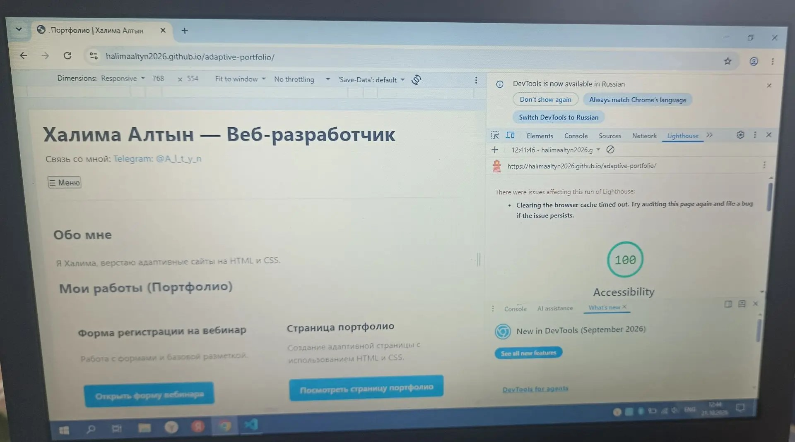
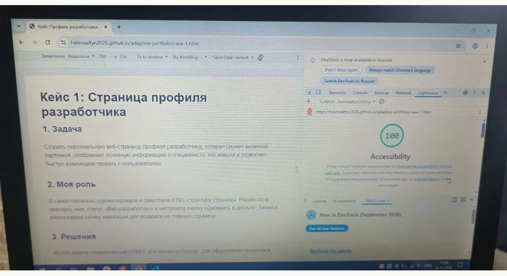
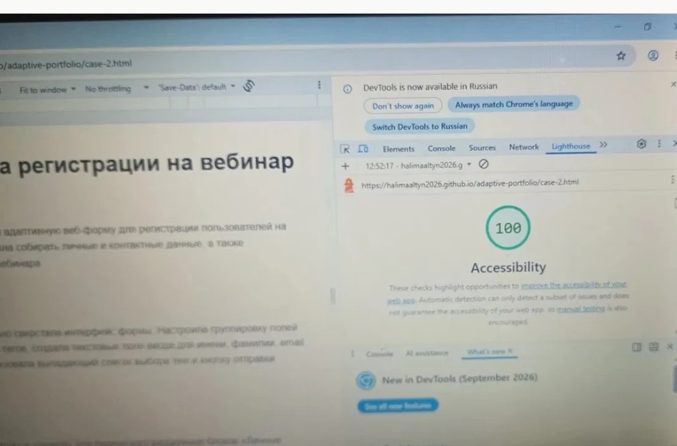
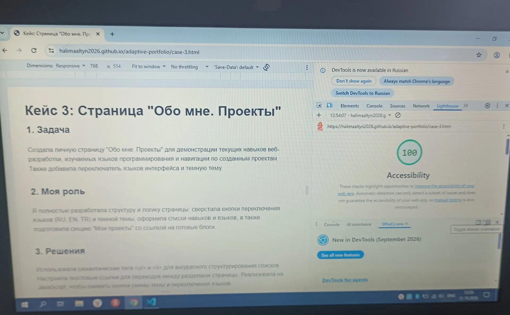

# Адаптивное портфолио: Халима Алтын

Личный сайт начинающего веб-разработчика: обо мне, мои навыки и три кейса.

## Адрес сайта

https://halimaaltyn2026.github.io/adaptive-portfolio/

Кейсы:
- https://halimaaltyn2026.github.io/adaptive-portfolio/case-1.html
- https://halimaaltyn2026.github.io/adaptive-portfolio/case-2.html
- https://halimaaltyn2026.github.io/adaptive-portfolio/case-3.html

## Как обновлять сайт

1. Изменить файлы в VS Code и сохранить.
2. В терминале выполнить: git add . затем git commit -m "описание изменений" затем git push.
3. Через 1-2 минуты изменения появятся на сайте (публикация идёт через GitHub Pages из ветки main).

## Где лежат материалы

- index.html, case-1.html, case-2.html, case-3.html, 404.html: страницы сайта
- style.css, script.js: оформление и скрипты
- docs/structure.md: описание структуры и материалы трёх работ
- файлы .jpg: скриншоты проектов и аудита

## Проверка перед публикацией

Дата проверки: 21.10.2026.
Инструмент: Lighthouse в Chrome, категория Accessibility.

| Страница | Accessibility |
| --- | --- |
| Главная | 100 |
| Кейс 1 | 100 |
| Кейс 2 | 100 |
| Кейс 3 | 100 |

Также проверены все ссылки (битых нет), открытие на телефоне и на чужом телефоне по мобильному интернету, отзыв человека со стороны.
### Скриншоты проверки

Главная:

Кейс 1:

Кейс 2:

Кейс 3:

